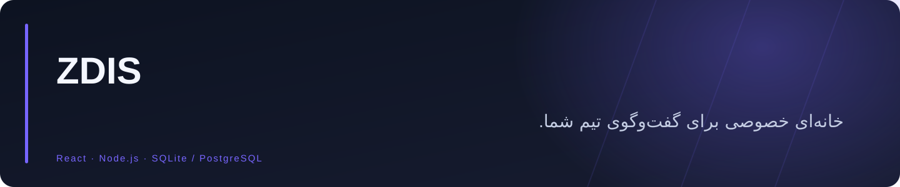
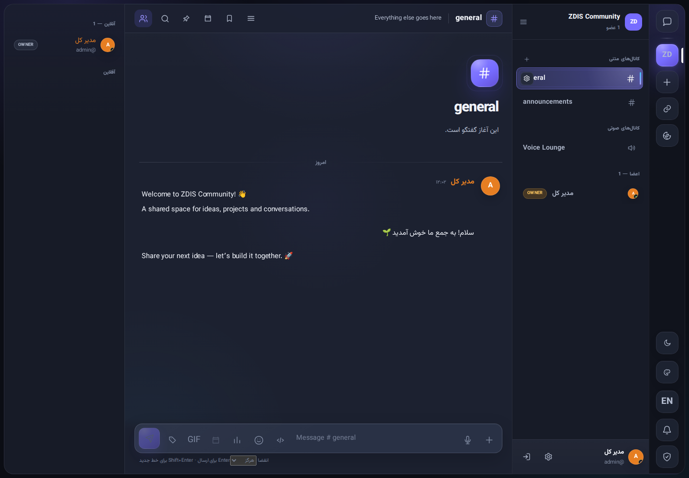
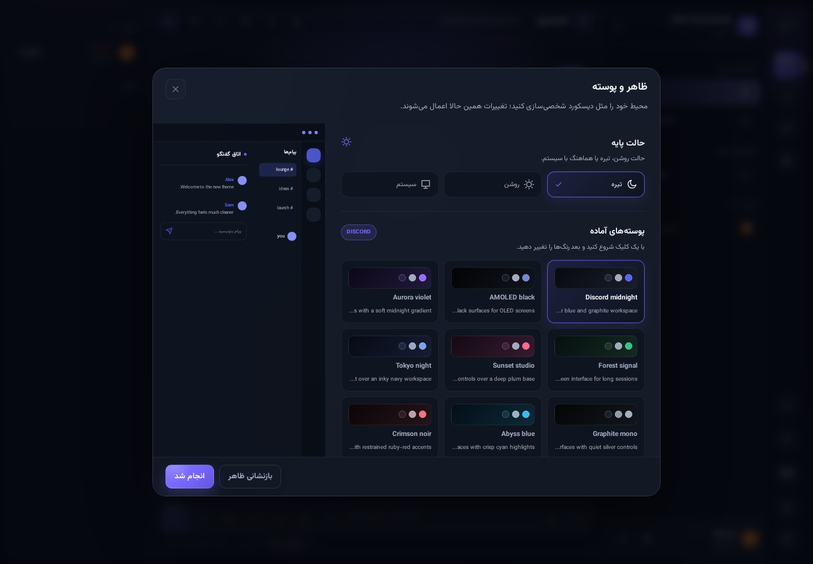

<div align="center">



**پلتفرم ارتباطی خودمیزبان برای سازندگان محتوا و تیم‌ها؛ با کانال، پیام خصوصی، تماس صوتی و تصویری، اشتراک فایل و حساب‌های تحت مدیریت مدیر.**


<a href="https://github.com/Realjustawall/zdis/actions/workflows/quality.yml"></a>

<a href="https://github.com/Realjustawall/zdis/releases/latest"></a>
<a href="docs/gallery.fa.md"></a>
<a href="#quick-start"></a>
<a href="https://github.com/Realjustawall/zdis/issues"></a>

[English](README.md) · [فارسی](README.fa.md)

</div>

---

[قابلیت‌های شاخص](#features) · [پیش‌نمایش](#preview) · [راه‌اندازی](#quick-start) · [توسعه](#development) · [مستندات](#documentation) · [امنیت و حریم خصوصی](#security) · [مجوز و بازخورد](#license)

<a id="features"></a>

## قابلیت‌های شاخص

| قابلیت | کاربرد |
|---|---|
| گفت‌وگوی منظم | گروه، کانال متنی، پیام خصوصی، رشتهٔ گفت‌وگو و اشتراک فایل. |
| تماس و فعالیت | تماس صوتی و تصویری، پیش‌نمایش دستگاه و فعالیت‌های کانال؛ اعمال محدودیت‌های SFU به پیکربندی LiveKit نیاز دارد. |
| مدیریت | ساخت حساب توسط مدیر، ربات‌های سرور، نظارت، سهمیه‌ها و نشان‌های اختصاصی. |
| میزبانی انعطاف‌پذیر | SQLite و ذخیره‌سازی محلی به‌صورت پیش‌فرض؛ PostgreSQL، Redis و امکانات سازمانی به‌صورت اختیاری. |
| رابط خوانا | رابط فارسی و انگلیسی، پوستهٔ روشن و تیره و تنظیمات ظاهر. |

<a id="preview"></a>

## پیش‌نمایش

ثبت‌شده از سرور محلی ZDIS و گروه آزمایشی.



<details>
<summary>تصاویر بیشتر</summary>



</details>

[مشاهدهٔ گالری کامل](docs/gallery.fa.md)

<a id="quick-start"></a>

## راه‌اندازی

**پیش‌نیاز محلی:** Node.js نسخهٔ ۲۴ یا جدیدتر و npm. برای SQLite به نصب سرور پایگاه‌داده نیاز نیست.

```bash
git clone https://github.com/Realjustawall/zdis.git
cd zdis
npm ci
npm run build
npm start
```

نشانی `http://localhost:4000` را باز کنید. ساخت حساب فقط توسط مدیر انجام می‌شود و ثبت‌نام عمومی وجود ندارد. `SEED_ADMIN_EMAIL` و `SEED_ADMIN_PASSWORD` را در `.env` تنظیم کنید، یا رمز تولیدشده در اولین راه‌اندازی را از خروجی سرور نگه دارید.

نصب بومی اوبونتو با `bash ubuntu/setup.sh` و سپس `bash ubuntu/start.sh` انجام می‌شود. برای استقرار کامل، [راهنمای اوبونتو](docs/UBUNTU_INSTALL.md) را بخوانید.

<a id="development"></a>

## توسعه

Node.js نسخهٔ ۲۴ یا جدیدتر؛ پروژه از workspaceهای npm استفاده می‌کند.

```bash
npm ci
npm run dev
# API: http://localhost:4000
# Client: http://localhost:5173
```

دستورهای بررسی:

```bash
npm test
npm run build
```

<a id="documentation"></a>

## مستندات

- [راهنمای اوبونتو](ubuntu/README.md)
- [استقرار عملیاتی](docs/UBUNTU_INSTALL.md)
- [نگهداری سازمانی](docs/ENTERPRISE.md)
- [تماس و فعالیت‌ها](docs/VOICE_ACTIVITIES.md)
- [ربات‌های سرور](docs/BOTS.md)
- [مجوز و سهمیه](docs/PERMISSIONS.md)
- [نسخهٔ حفظ‌شدهٔ مستندات پیشین](REFERENCE.md)

<a id="security"></a>

## امنیت و حریم خصوصی

در محیط عملیاتی از HTTPS و کوکی امن استفاده کنید. نشانی عمومی، اعتماد به پراکسی و سیاست پیوست را متناسب با استقرار تنظیم کنید. ClamAV امکان بررسی بدافزار شناخته‌شده را اضافه می‌کند؛ محدودیت‌های مربوط به انتشار صدا به تنظیم LiveKit/SFU نیاز دارند. اجرای درست کنترل‌های امنیتی به پیکربندی وابسته است.

<a id="license"></a>

## مجوز و بازخورد

سورس تحت [مجوز غیرتجاری ZDis](LICENSE) در دسترس است؛ استفادهٔ تجاری به مجوز جداگانه نیاز دارد.

[گزارش اشکال و پیشنهاد بهبود](https://github.com/Realjustawall/zdis/issues). نسخه، سیستم‌عامل و روش بازتولید را بنویسید و اطلاعات خصوصی یا رمزها را در گزارش قرار ندهید.

---

نگهداری توسط **[Realjustawall](https://github.com/Realjustawall)**.
