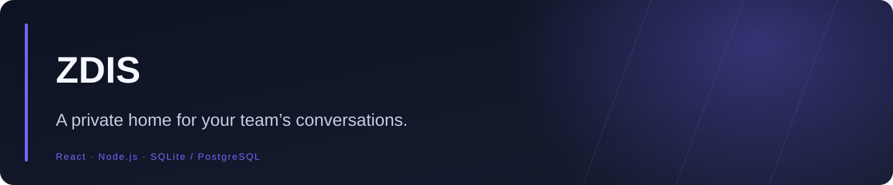
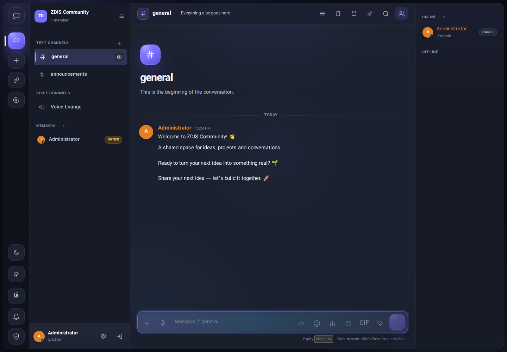
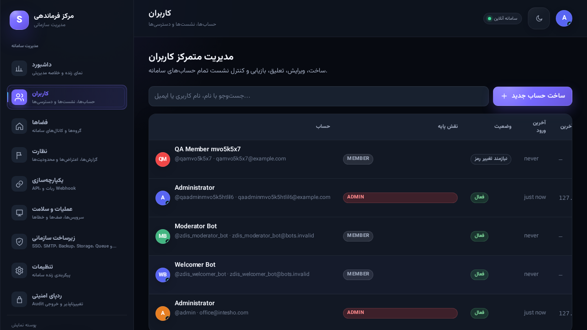

<div align="center">



**Self-hosted communication for creators and teams: channels, direct messages, voice/video, file sharing and administrator-managed accounts.**


<a href="https://github.com/Realjustawall/zdis/actions/workflows/quality.yml"></a>

<a href="https://github.com/Realjustawall/zdis/releases/latest"></a>
<a href="docs/gallery.en.md"></a>
<a href="#quick-start"></a>
<a href="https://github.com/Realjustawall/zdis/issues"></a>

[English](README.md) · [فارسی](README.fa.md)

</div>

---

[Highlights](#features) · [Preview](#preview) · [Quick start](#quick-start) · [Development](#development) · [Documentation](#documentation) · [Security and privacy](#security) · [License and feedback](#license)

<a id="features"></a>

## Highlights

| Capability | What you get |
|---|---|
| Organized conversation | Groups, text channels, direct messages, threads and shared files. |
| Calls and activities | Voice/video workflows, device preview and channel activities; LiveKit configuration is required for enforced SFU permissions. |
| Administration | Administrator-created accounts, server bots, moderation, quotas and custom badges. |
| Flexible hosting | SQLite and local storage by default; optional PostgreSQL, Redis and enterprise integrations. |
| Comfortable reading | Persian/English interface, light/dark themes and appearance presets. |

<a id="preview"></a>

## Preview

Captured from the running app with disposable demo data. Phone captures show the Persian interface; desktop captures are available in both languages.






[مشاهدهٔ 62 تصویر پیش‌نمایش](docs/gallery.fa.md) · [View all 62 previews](docs/gallery.en.md)

<a id="quick-start"></a>

## Quick start

**Local requirements:** Node.js 24+ and npm. SQLite works without a separate database server.

```bash
git clone https://github.com/Realjustawall/zdis.git
cd zdis
npm ci
npm run build
npm start
```

Open `http://localhost:4000`. Accounts are provisioned by an administrator; public sign-up is not available. Configure `SEED_ADMIN_EMAIL` and `SEED_ADMIN_PASSWORD` in `.env`, or retain the generated password printed once on first startup.

For native Ubuntu setup, use `bash ubuntu/setup.sh` followed by `bash ubuntu/start.sh`. For the complete production stack, follow the [Ubuntu deployment guide](docs/UBUNTU_INSTALL.md).

<a id="development"></a>

## Development

Node.js 24+; npm workspaces.

```bash
npm ci
npm run dev
# API: http://localhost:4000
# Client: http://localhost:5173
```

Validation commands:

```bash
npm test
npm run build
```

<a id="documentation"></a>

## Documentation

- [Ubuntu setup](ubuntu/README.md)
- [Production deployment](docs/UBUNTU_INSTALL.md)
- [Enterprise operations](docs/ENTERPRISE.md)
- [Voice and activities](docs/VOICE_ACTIVITIES.md)
- [Server bots](docs/BOTS.md)
- [Permissions and quotas](docs/PERMISSIONS.md)
- [Preserved documentation reference](REFERENCE.md)

<a id="security"></a>

## Security and privacy

Use HTTPS and secure cookies for production. Configure the public origin, proxy handling and upload policies for your deployment. ClamAV can add known-malware scanning; LiveKit/SFU settings are needed to enforce relevant voice publication restrictions. Security controls depend on deployment configuration.

<a id="license"></a>

## License and feedback

Source-available under the [ZDis non-commercial license](LICENSE). Commercial use needs a separate license.

[Report bugs or discuss improvements](https://github.com/Realjustawall/zdis/issues). Include your version, OS and reproducible steps; keep credentials and private data out of reports.

---

Maintained by **[Realjustawall](https://github.com/Realjustawall)**.
